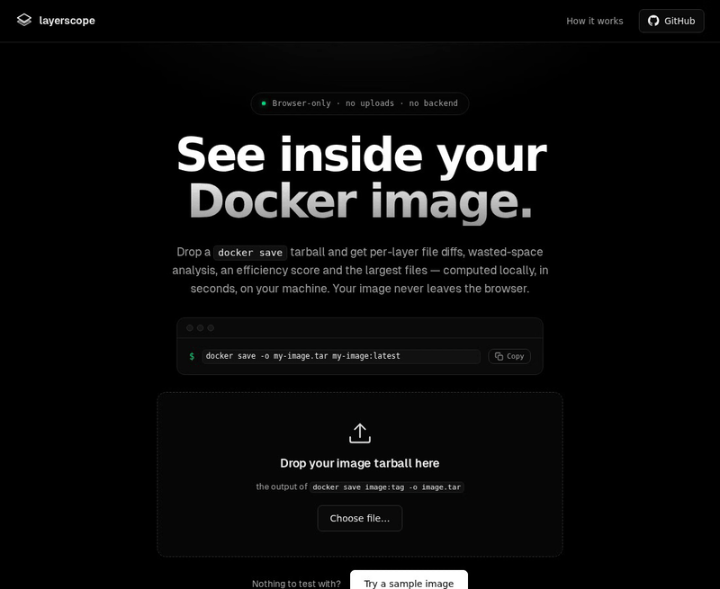

# layerscope

<p align="center">
  
</p>
<p align="center"><sub>Recorded on <a href="https://revolover00.github.io/layerscope/">the live site</a> with a deliberately wasteful example image (cleanup in a separate layer).</sub></p>

[](https://github.com/revolover00/layerscope/actions/workflows/ci.yml)
[](https://github.com/revolover00/layerscope/actions/workflows/pages.yml)
[](LICENSE)
[](https://github.com/revolover00/layerscope/releases)

**See inside your Docker image.** Layers, file changes and wasted space, right in your browser. Nothing is uploaded.

Drop a `.tar` from `docker save` onto the page and layerscope shows what each layer adds, modifies and deletes, which bytes are dead weight in earlier layers, an efficiency score, and the 20 largest files. No install, no account, no backend: the whole app is static files.

## Try it

1. Open <https://revolover00.github.io/layerscope/>
2. Make a tarball and drop it on the page:
   ```bash
   docker save -o my-image.tar my-image:latest
   ```
3. No image handy? Click **Try a sample image**, or drop `assets/samples/layerscope-demo.tar`.

## Why

- **Nothing to install, nothing uploaded.** Your file is read in the browser. You can check in DevTools -> Network that no request carries it.
- **Numbers follow dive.** Efficiency and wasted bytes use [dive](https://github.com/wagoodman/dive)'s definitions, and the output is compared with dive in CI.
- **It tells you what to fix.** Besides dive's *Wasted* number it shows *Reclaimable*: wasted bytes minus the copies that still exist in the final image, i.e. what you would actually save by fixing the Dockerfile.

## What you get

- Per layer: size, creating command, and files added / modified / deleted (whiteouts and opaque directories handled)
- Image efficiency score, wasted bytes and reclaimable bytes
- The 20 largest files, across all layers or in the final image
- Legacy `docker save` and OCI archives, gzip and zstd layers, a platform picker for multi-arch OCI indexes

## layerscope vs dive

| | layerscope | dive |
|---|---|---|
| Install | none, open a URL | binary, package or container |
| Where it runs | your browser | your terminal |
| Input | `docker save` tarball (legacy and OCI) | Docker daemon, Podman, docker-archive |
| CI gate (`--ci`) | no | yes |
| Interactive terminal UI | no | yes |
| Best for | a quick look without installing anything | day-to-day local use and CI checks |

Use dive if you need it in CI or want to inspect an image straight from the daemon.

## Verification

- Unit tests (`npm test`) and a jsdom UI smoke test
- 17 of dive's golden fixtures, pinned to upstream commit `e97febb`
- Six public images (alpine, busybox, nginx:alpine, python:3.12-slim, node:20-alpine, ubuntu:24.04) compared with the dive v0.13.1 CLI in CI
- A real-Chromium job in CI that analyses fixed fixtures and checks the numbers

Efficiency is compared with a relative tolerance of 1e-9; everything else must match exactly. The only normalisation is the order of equal-size entries in dive's `fileReference` list, which is undefined in dive v0.13.1. Details: [docs/VERIFICATION.md](docs/VERIFICATION.md).

## Limitations

- Expects an uncompressed `docker save` tar. `.tar.gz` / `.tar.zst` wrappers are detected and rejected with a clear message.
- The zstd fallback decoder (used where the browser has no native zstd) refuses a single layer larger than 160 MiB and may fail on "ultra" levels with very large windows; gzip layers stream and are not affected.
- Analyses one image at a time (multi-image `manifest.json`: first entry only). OCI multi-arch indexes use a platform picker over what is inside the archive; no registry or Docker daemon access.
- Tested in Chromium only. Safari and Firefox are untested.
- Deleting a file in a later layer still counts as waste, by design. No rename detection.

## Run locally

```bash
python3 -m http.server 8080   # or: npx serve .
# open http://localhost:8080/
npm test
```

## How it was built

Built with AI assistance (Claude / an AI coding agent). Correctness is checked against dive as described above, not assumed.

## More

[How it works](docs/HOW-IT-WORKS.md) · [Benchmarks](docs/BENCHMARKS.md) · [Architecture and decoder notes](docs/ARCHITECTURE.md) · [Changelog](CHANGELOG.md) · [Contributing](CONTRIBUTING.md) · [Security](SECURITY.md)

## Credits and license

- [dive](https://github.com/wagoodman/dive) (wagoodman, MIT): the analysis model, efficiency and wasted-bytes definitions are ported from it; its golden files are used for verification.
- [fzstd](https://github.com/101Arrowz/fzstd) (101Arrowz, MIT): fallback zstd decoder.
- [Geist](https://github.com/vercel/geist-font) (Vercel, OFL): fonts.

[MIT](LICENSE)
